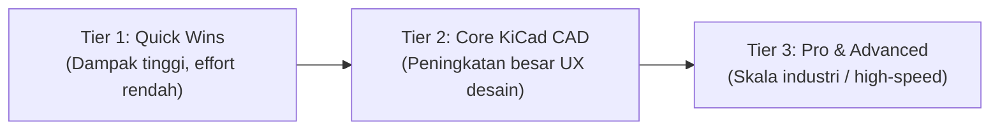

# Riset Fitur KiCad yang Dapat Diimplementasikan ke Just Circuit

Dokumen ini memetakan fitur-fitur utama dari **KiCad (versi 8 & 9)**—mencakup **Eeschema**, **Pcbnew**, **SPICE Simulator**, **PCB Calculator**, **Symbol/Footprint Editor**, **DRC/ERC**, dan **Jobsets**—serta mengevaluasi bagaimana masing-masing bisa diimplementasikan secara realistis ke arsitektur hybrid **Just Circuit** (AI Agent + Visual CAD + Kode TSX).

---

## 1. Temuan Kunci dari Analisis Codebase Just Circuit

Sebelum menentukan fitur baru, pemeriksaan langsung terhadap paket yang sudah terpasang di [`package.json`](file:///Users/yay/Project/just-circuit/package.json) (`@tscircuit/props@0.0.732`, `@tscircuit/core@0.0.2385`, `kicad-to-circuit-json@0.0.149`) menunjukkan dua fakta penting:

1. **Fondasi Hybrid CAD sudah aktif:**
   - Editor Skematik interaktif ([`SchematicEditor.tsx`](file:///Users/yay/Project/just-circuit/src/components/cad/SchematicEditor.tsx)), Editor PCB + Copper Trace manual ([`PcbCadEditor.tsx`](file:///Users/yay/Project/just-circuit/src/components/cad/PcbCadEditor.tsx)), Inspektor Properti 2-arah ([`PropertyInspector.tsx`](file:///Users/yay/Project/just-circuit/src/components/cad/PropertyInspector.tsx)), TSX AST Patcher ([`tsx-ast.ts`](file:///Users/yay/Project/just-circuit/src/lib/tsx-ast.ts)), Undo/Redo per-file ([`undo-history.ts`](file:///Users/yay/Project/just-circuit/src/lib/undo-history.ts)), Simulasi DC MNA ([`circuit-sim.ts`](file:///Users/yay/Project/just-circuit/src/lib/circuit-sim.ts)), unggah `.kicad_mod`, dan impor dasar `.kicad_pcb`/`.kicad_sch` ([`kicad-import.ts`](file:///Users/yay/Project/just-circuit/src/lib/kicad-import.ts)).
2. **Banyak primitif kelas-KiCad SUDAH ADA di `@tscircuit/props`, namun belum memiliki UI/CAD:**
   - `<copperpour>`, `<differentialpair>`, `<bus>`, `<net>`, `<netalias>`, `<fanout>`, `<breakout>`, `<drccheck>`, `<autoroutingphase>`
   - `<schematicsheet>`, `<schematictable>`, `<schematictext>`, `<schematicline>`/`<schematicrect>`/`<schematiccircle>`
   - `<cutout>` (rect/circle/polygon), `<fiducial>`, `<testpoint>`, `<solderjumper>`, `<pcbnotedimension>`, `<fabricationnotetext>`, `<silkscreen...>`
   - `<panel>`, `<subpanel>`, `<paneltab>`, `<toolingrail>`, `<pcbbend>` (Flex PCB), `isCastellatedHole`, `fabricatorPreset`, `layers` (1–10), `defaultViaTenting`
   - Primitif SPICE lengkap (`<analogtransientsimulation>`, `<analogacsweep>`, `<analogdcsweep>`, `<analogeyediagram>`, `<voltageprobe>`, `<ammeter>`, `<spicemodel>`, `<pcbreturncurrentsimulation>`)
   - `KicadSymbolToCircuitJsonConverter` (untuk impor **`.kicad_sym`**) dan `CollectZonesStage` / `CollectSourceTracesStage` di `kicad-to-circuit-json`.

Artinya, banyak fitur besar KiCad bisa diwujudkan di Just Circuit dengan **effort sedang** karena engine render/eval di bawahnya sudah mendukung—tinggal membangun lapisan UI, interaksi kanvas, AST patcher, dan integrasi AI Agent.

---

## 2. Katalog Lengkap Fitur KiCad untuk Just Circuit

### A. PCB Layout & Routing (Pcbnew)

| Fitur KiCad | Padanan di Just Circuit / tscircuit | Nilai Tambah Mode Hybrid (AI + Manual) | Kompleksitas |
|---|---|---|---|
| **Copper Pour & Zone Manager** (GND/Power plane, thermal relief, prioritas) | `<copperpour net="GND" layer="bottom" useThermalReliefs />` | Tombol "Tambah Ground Plane" di PCB CAD + daftar zone dengan toggle visibilitas & prioritas. | Rendah–Sedang |
| **Edit / Hapus Copper Trace & Via yang Sudah Ada** | Klik `<pcbtrace>` / `<via>` di `PcbCadEditor`, ubah lebar/layer, seret vertex, atau `Del` untuk menghapus. | Saat ini baru bisa *menambah* trace manual; mengedit & menghapus trace spesifik adalah kebutuhan nomor 1 untuk routing manual. | Sedang |
| **45° Mitered Routing & Live Length Readout** | Saat tool `X` aktif, otomatis membentuk sudut 45° (toggle postur dengan `/`), menampilkan panjang jalur (`mm`) & perkiraan resistansi/drop tegangan real-time. | Menghasilkan routing manual yang rapi dan siap produksi layaknya Pcbnew. | Sedang |
| **Net Highlighting & Net Inspector** | Klik pad/trace/net untuk menyorot seluruh pad, trace, via, dan airwire pada net itu; tampilkan total panjang trace, lebar terkecil, dan kapasitas arus (IPC-2221). | Memudahkan melacak jalur power/sinyal di board padat (100+ komponen). | Rendah–Sedang |
| **Board Cutout & Polygon Board Outline Editor** | `<cutout>` (slot/lubang persegi/lingkaran/poligon) & edit titik vertex `outline` pada `<board>` (termasuk `borderRadius` & `isCastellatedHole`). | Memungkinkan bentuk PCB non-persegi (bulat, L-shape, slot konektor, modul castellated). | Sedang |
| **Selection Filter (KiCad 9)** | Panel centang filter seleksi di kanvas (Komponen, Trace, Via, Zone, Hole, Teks/Silkscreen). | Mencegah salah klik komponen saat sedang merapikan trace atau sebaliknya. | Rendah |
| **Multi-Select, Align, Distribute & Array/Multichannel** | Box-select beberapa komponen → Align Left/Right/Top/Center, Distribute Horizontal/Vertical, Move bersama, Duplicate (`Ctrl+D`). | Sangat mempercepat penataan barisan LED, header, kanal I/O PLC, dan resistor array. | Sedang |
| **Differential Pair & Length Matching** | `<differentialpair positiveConnection="..." negativeConnection="..." maxLengthSkew={0.05} />` + UI penandaan pasangan USB/CAN/Ethernet/LVDS + indikator skew. | AI & pengguna bisa menetapkan constraint high-speed tanpa perlu menghitung meander manual di awal. | Sedang |
| **Net Classes & Custom DRC Rules** | `<net>` + `<drccheck>` (mis. kelas `POWER` lebar 0.6mm clearance 0.3mm; kelas `HIGH_VOLTAGE` clearance 1.5mm). | Aturan DRC kustom masuk ke kode TSX sekaligus dibaca AI agar desain otomatis patuh aturan keselamatan. | Sedang |
| **Silkscreen, Dimensi & Elemen Manufaktur** | Toolbar tambah teks silkscreen, garis/kotak, dimensi (`<pcbnotedimension>`), `<fiducial>`, `<testpoint>`, `<solderjumper>`. | Membuat PCB siap perakitan SMT dan dokumentasi mekanikal tanpa keluar dari aplikasi. | Rendah–Sedang |
| **Panelisasi (V-Score / Mouse-Bites)** | `<panel>`, `<subpanel>`, `<paneltab>`, `<toolingrail>` — dialog wizard untuk menggandakan board menjadi panel `N×M` untuk pabrik. | Fitur yang bahkan di KiCad butuh plugin pihak ketiga (KiKit), tapi sudah ada primitifnya di tscircuit! | Sedang |

---

### B. Schematic Capture & Produktivitas (Eeschema)

| Fitur KiCad | Padanan di Just Circuit / tscircuit | Nilai Tambah Mode Hybrid (AI + Manual) | Kompleksitas |
|---|---|---|---|
| **Symbol Fields Table (Bulk Property Editor)** | Tabel spreadsheet semua komponen (Designator, Value, Footprint, MPN, LCSC/Supplier PN, Deskripsi, Layer) yang bisa diedit masal + filter/sort, langsung mem-patch TSX via AST. | Salah satu fitur paling dicintai di KiCad—mengubah semua resistor `0402` → `0603` atau mengisi MPN puluhan part dalam hitungan detik. | Rendah–Sedang |
| **Cross-Probing (Skematik ↔ PCB ↔ Kode ↔ BOM)** | State `selectedComponent` & `selectedNet` bersama di seluruh studio: klik `U3` di Skematik langsung menyorot & fokus ke `U3` di PCB, membuka barisnya di Monaco, dan menyorot di BOM. | Menghilangkan friksi berpindah-pindah antar tampilan di board besar. | Rendah–Sedang |
| **Hierarchical Sheets & Block Diagram** | `<schematicsheet>` + `<group showAsSchematicBox schTitle="..." exposedNets={[...]} />` — navigasi klik-ganda masuk ke sub-sheet (mis. `lib/power.tsx`, `lib/plc-io.tsx`). | Sangat krusial untuk proyek modular besar (seperti PLC ratusan komponen) agar skematik tetap bersih & mudah dibaca. | Sedang–Tinggi |
| **Bus & Net Alias** | `<bus>` & `<netalias>` — mengelompokkan sinyal seperti `SPI[0..3]` atau `GPIO[0..7]` pada kanvas skematik. | Mengurangi keruwetan kabel skematik untuk MCU/FPGA. | Sedang |
| **Auto-Annotate (Renumber Designators)** | Tool penomoran ulang otomatis `R1..Rn`, `C1..Cn` berdasarkan urutan posisi (kiri→kanan, atas→bawah) sambil memperbarui semua selector `<trace>` terkait via AST. | Merapikan designator acak hasil iterasi cepat dengan AI atau edit manual. | Sedang |
| **Schematic Tables & Annotations (KiCad 9)** | `<schematictable>` (tabel pinout/jumper/revisi di lembar skematik), `<schematictext>`, kotak blok fungsional (`<schematicrect>`), dan Title Block (`title`, revisi, tanggal). | Dokumentasi skematik berstandar industri langsung di dalam desain. | Rendah–Sedang |
| **ERC Lanjutan (Power Flag, Pin Direction, Unconnected `X`)** | Pemeriksaan ERC lebih ketat di atas `circuitJson`: pin output-ke-output short, pin input mengambang tanpa pull-up/down, dan penanda `no_connect` eksplisit. | Menangkap kesalahan logika rangkaian sebelum masuk tahap layout PCB. | Sedang |

---

### C. Board Setup, Stackup & Manufaktur

| Fitur KiCad | Padanan di Just Circuit / tscircuit | Nilai Tambah Mode Hybrid (AI + Manual) | Kompleksitas |
|---|---|---|---|
| **Board Setup & Layer Stackup Dialog** | Dialog terstruktur yang membaca & menulis props `<board>`: jumlah layer (`1/2/4/6/8/10`), material (`FR4`/`FR1`/`Flex`), ketebalan (`1.6mm`/`0.8mm`), `fabricatorPreset` (JLCPCB Economy/Standard), `defaultViaTenting`, `allowBlindAndBuriedVias`, aturan clearance default. | Menggantikan penulisan aturan board secara manual di teks "Aturan tambahan AI" (juga sudah tercatat di Roadmap Fase 2!). | Rendah |
| **Interactive BOM / Assembly Map** *(ala plugin KiCad `InteractiveHtmlBom`)* | Tampilan BOM interaktif di sisi kiri + peta PCB di sisi kanan: klik baris `100nF 0603 (qty 14)` → menyorot ke-14 posisi kapasitor di PCB + checklist "Sudah disolder". | Sangat membantu saat menyolder prototipe secara manual atau inspeksi hasil perakitan. | Rendah–Sedang |
| **Output Jobsets (KiCad 9)** | Preset 1-klik "Paket Produksi": menjalankan `DRC + Simulasi DC + Ekspor Gerber + Drill + BOM CSV + CPL (Pick & Place) + STEP 3D` lalu mengemasnya jadi 1 arsip ZIP siap unggah ke JLCPCB/PCBWay. | Memastikan tidak ada file yang lupa diekspor atau board diproduksi dalam kondisi error. | Sedang |

---

### D. Simulasi, Kalkulator & Analisis Kelistrikan

| Fitur KiCad | Padanan di Just Circuit / tscircuit | Nilai Tambah Mode Hybrid (AI + Manual) | Kompleksitas |
|---|---|---|---|
| **KiCad PCB Calculator Suite** | Dialog kalkulator terintegrasi (100% client-side, nol dependensi berat): 1. **Track Width & Current (IPC-2221 / IPC-2152)** 2. **Via Current & Resistance** 3. **Microstrip / Stripline / Diff-Pair Impedance** 4. **Voltage Divider & Nearest E24/E96 Resistor** 5. **LED Current-Limiting Resistor & Wattage** 6. **High-Voltage Track Clearance (IPC-2221)** 7. **RC / LC Cutoff Frequency & Buck/LDO Feedback Divider** Bonus: tombol **"Terapkan ke kode / Kirim ke AI"**. | Sangat cepat dibangun, sangat berguna sehari-hari, dan jauh lebih terintegrasi dibanding kalkulator terpisah karena hasilnya langsung bisa diterapkan ke komponen/net proyek. | Rendah |
| **Visualisasi Heatmap Arus & Kapasitas Trace di PCB** | Menggabungkan output [`circuit-sim.ts`](file:///Users/yay/Project/just-circuit/src/lib/circuit-sim.ts) dengan lebar `pcb_trace` dari `circuitJson` → menampilkan overlay warna pada jalur PCB (hijau = aman, kuning = hangat, merah = arus melebihi kapasitas lebar tembaga IPC-2221). | Pengguna langsung *melihat secara visual* jalur power mana yang terlalu tipis untuk arusnya! | Rendah–Sedang |
| **Simulasi SPICE Penuh (Transient, AC Sweep / Bode Plot, DC Sweep)** | Memanfaatkan primitif SPICE `@tscircuit/props` (`<analogtransientsimulation>`, `<analogacsweep>`, `<voltageprobe>`, `<ammeter>`, `<spicemodel>`) + plotting grafik interaktif (waveform tegangan/arus terhadap waktu & respons frekuensi) — bisa dijalankan lewat engine ngspice WASM di browser atau `ngspice` di server. | Mengangkat simulasi dari sekadar cek DC statis menjadi analisis osilator 555, filter RC/op-amp, buck converter, dan respons transien yang sesungguhnya. | Tinggi |

---

### E. Footprint/Symbol Editor & Ekosistem KiCad

| Fitur KiCad | Padanan di Just Circuit / tscircuit | Nilai Tambah Mode Hybrid (AI + Manual) | Kompleksitas |
|---|---|---|---|
| **Impor `.kicad_sym` (Library Simbol KiCad)** | Memanfaatkan `KicadSymbolToCircuitJsonConverter` yang sudah ada di `kicad-to-circuit-json` (melengkapi unggah `.kicad_mod` yang sudah berjalan). | Pengguna bisa mengunggah simbol resmi pabrikan/SnapEDA/Ultra Librarian beserta footprint-nya. | Rendah–Sedang |
| **Upgrade Impor `.kicad_pcb` / `.kicad_sch` Penuh** | Memperluas [`kicad-import.ts`](file:///Users/yay/Project/just-circuit/src/lib/kicad-import.ts) agar ikut mengonversi **netlist (`<trace>`)**, **copper pour (`<copperpour>`)**, dan **footprint kustom asli** (bukan fallback `0603`/`soic8`). | Proyek KiCad lama bisa dimigrasikan utuh ke Just Circuit tanpa kehilangan koneksi atau footprint khusus. | Sedang–Tinggi |
| **Visual Footprint & Symbol Wizard / Editor** | Editor grafis khusus untuk membuat komponen baru: pilih tipe paket (SOIC, QFN, QFP, BGA, Pin Header, Terminal Block), atur jumlah pin, pitch, ukuran pad, silkscreen, courtyard, dan tautkan model 3D (`.step`/`.glb` via `<cadmodel>`) → menghasilkan file TSX bersih di `lib/parts/`. | Menghapus ketergantungan pada pencarian part eksternal saat memakai komponen unik/mekanikal. | Sedang–Tinggi |
| **Integrasi Opsional `kicad-cli` di Server** | Jika `kicad-cli` terdeteksi di mesin server, sediakan tombol untuk menjalankan DRC/ERC native KiCad dan ekspor PDF/STEP/ODB++ dari file KiCad hasil ekspor proyek. | Memberi jaminan verifikasi standar industri (KiCad native DRC) bagi pengguna yang menginstal KiCad di mesin/server-nya. | Sedang |

---

## 3. Fitur KiCad yang Sebaiknya TIDAK Ditiru Langsung (Anti-Pattern untuk Just Circuit)

Agar arsitektur hybrid Just Circuit tetap ringan, cepat, dan ramah AI Agent:
1. **Jangan mem-porting engine C++ Push-and-Shove Router penuh (PNS) ke WASM**: biaya perawatan terlalu tinggi dan bentrok dengan model kode TSX. Kombinasi **routing manual 45° + edit/drag vertex `<pcbtrace>` + `<autoroutingphase>` + AI Agent** jauh lebih efisien dan tetap 100% sinkron dengan kode.
2. **Jangan memisahkan skematik dan PCB menjadi dua netlist manual ("Update PCB from Schematic" manual)**: di Just Circuit, skematik dan PCB sudah terikat ke satu sumber kebenaran (kode TSX). Justru keunggulan terbesar Just Circuit dibanding KiCad adalah tidak pernah terjadi *netlist desync*.
3. **Jangan meniru manajemen path library lokal KiCad (`sym-lib-table` / `fp-lib-table`) yang rumit**: pertahankan sistem Just Circuit yang lebih modern (Library terpadu + pencarian multi-sumber + cache KiCad otomatis + unggah `.kicad_mod`/`.kicad_sym`).

---

## 4. Rekomendasi Urutan Prioritas Implementasi

### Tier 1 — Quick Wins (Paling cepat memberi rasa "KiCad Pro")
1. **Board Setup & Stackup Dialog** (`layers`, `material`, `fabricatorPreset`, `thickness`, `viaTenting`, clearance) — langsung melengkapi dialog Pengaturan & menulis ke `<board>`.
2. **PCB Calculator Suite (IPC-2221, Impedance, Divider, LED, Via)** + tombol *"Terapkan / Kirim ke AI"*.
3. **Symbol Fields Table (Bulk Property Editor)** — tabel spreadsheet edit cepat Value, Footprint, MPN, Supplier PN seluruh komponen sekaligus.
4. **Copper Pour (`<copperpour>`) & Selection Filter** di `PcbCadEditor`.
5. **Cross-Probing + Net Highlighting** (klik komponen/net di satu panel → sorot di Skematik, PCB, dan loncat ke kode).

### Tier 2 — Core KiCad CAD Experience
6. **Edit/Hapus `<pcbtrace>` & 45° Mitered Routing + Live Length & Ampacity Heatmap** di `PcbCadEditor`.
7. **Multi-Select, Align & Distribute, Duplicate (`Ctrl+D`)** di kedua kanvas CAD.
8. **Interactive BOM / Assembly Map** (highlight posisi semua part identik di PCB).
9. **Impor `.kicad_sym` & Upgrade Impor `.kicad_pcb`/`.kicad_sch`** (membawa `<trace>` netlist, zone, dan footprint asli).
10. **Output Jobsets (1-klik Paket Produksi)**: DRC + Simulasi DC + Gerber + Drill + BOM + CPL dalam satu alur.

### Tier 3 — Pro / High-Speed / Multi-Sheet
11. **Hierarchical Sheets (`<schematicsheet>` / `<group showAsSchematicBox>`) & Bus (`<bus>`)** untuk board besar.
12. **Differential Pairs (`<differentialpair>`), Net Classes & Custom DRC Rules (`<drccheck>`)**.
13. **Simulasi SPICE Penuh** (Transient waveform, AC Sweep / Bode Plot, DC Sweep dengan `ngspice`/primitif SPICE tscircuit).
14. **Visual Footprint & Symbol Wizard** + **Panelisasi (`<panel>`)** + integrasi opsional **`kicad-cli`** di server.
